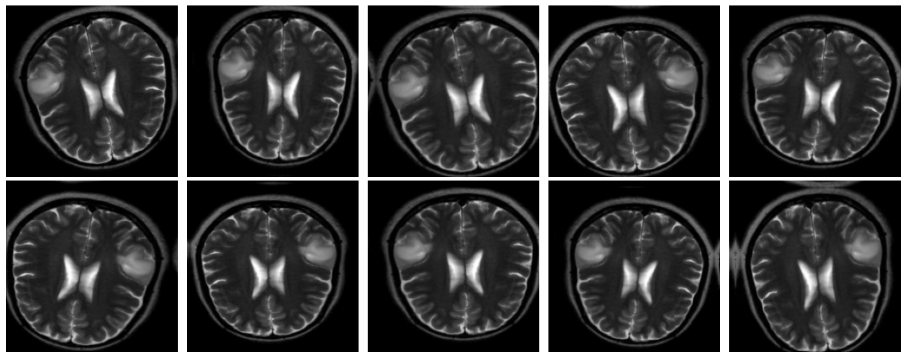
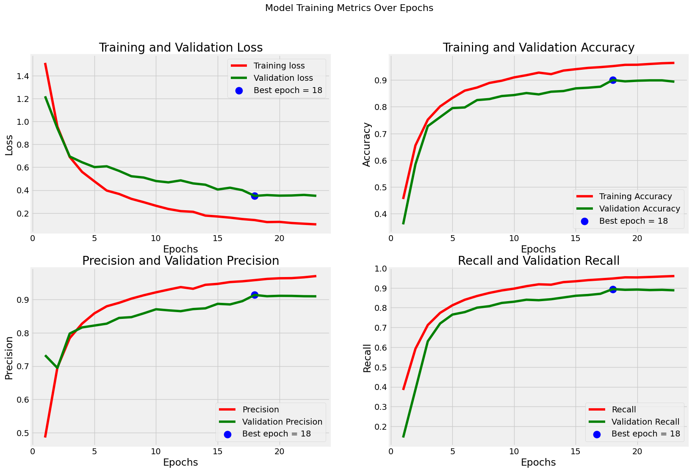

# Brain Tumor MRI Classification

Deep learning pipeline for classifying brain tumors from MRI images using **EfficientNetV2B0** with transfer learning.

## Overview

This project automatically classifies MRI brain scans into four categories:

| Class       | Description          |
|-------------|----------------------|
| **Glioma**  | Glioma tumor         |
| **Meningioma** | Meningioma tumor  |
| **No Tumor**   | Healthy brain    |
| **Pituitary**  | Pituitary tumor  |

## Dataset

The [Brain Tumor MRI Dataset](https://www.kaggle.com/datasets/masoudnickparvar/brain-tumor-mri-dataset) from Kaggle is used, containing:

- **Training**: 5,600 images (4 classes)
- **Testing**:  1,600 images (4 classes)
  - Split into 800 validation / 800 test

## Architecture

- **Backbone**: EfficientNetV2B0 (pretrained on ImageNet)
- **Input**: Grayscale MRI (256×256), expanded to 3-channel via concatenation
- **Head**: GlobalAveragePooling → BatchNorm → Dropout → Dense(256, ReLU) → Dense(128, ReLU) → Dense(128, ReLU) → BatchNorm → Dropout → Dense(4, Softmax)
- **Total params**: 6,302,804 (trainable: 6,239,380)

### Data Augmentation



Applied only in the `tf.data` pipeline (not inside the saved model) to avoid version-mismatch issues:
- Random horizontal flip
- Random rotation (±10°)
- Random zoom (±10%)
- Random translation (±5%)

### Training Performance



- **Optimizer**: Adam (lr=3e-5)
- **Loss**: Categorical Crossentropy
- **Metrics**: Accuracy, Precision, Recall, AUC
- **Callbacks**: EarlyStopping (patience=5), ReduceLROnPlateau, ModelCheckpoint, TensorBoard
- **Best Validation Accuracy**: ~84%

## ONNX Deployment

The `tensorflow2ONNX.ipynb` notebook converts the trained model to ONNX format for faster inference:

| Backend  | Accuracy | Inference Time (800 images) |
|----------|----------|----------------------------|
| Keras    | 98.44%   | 14,889 ms                  |
| ONNX     | 98.44%   | 2,063 ms **(7× faster)**   |

Both outputs are **100% identical** in predictions.

## Usage

### Requirements

```
tensorflow
tf2onnx
onnxruntime
pillow
numpy
matplotlib
```

### Training

Open `Brain_tumor_MRI_V_4.ipynb` in Jupyter and run all cells.

### ONNX Inference

```python
import onnxruntime as ort

session = ort.InferenceSession("model.onnx")
result = session.run(None, {"mri_input": image_array})
```

## Project Structure

```
├── Brain_tumor_MRI_V_4.ipynb   # Training & evaluation
├── tensorflow2ONNX.ipynb        # Keras → ONNX conversion
├── Charts/
│   ├── Augmentation.png         # Augmentation samples
│   └── Chart.png                # Accuracy/loss curves
├── Datatset/                    # (ignored by git)
├── Model_EfficientNetV2B0/      # Saved models (ignored by git)
└── logs/                        # TensorBoard logs (ignored by git)
```
